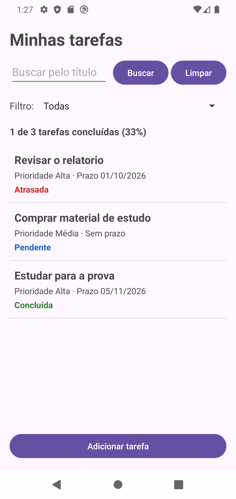
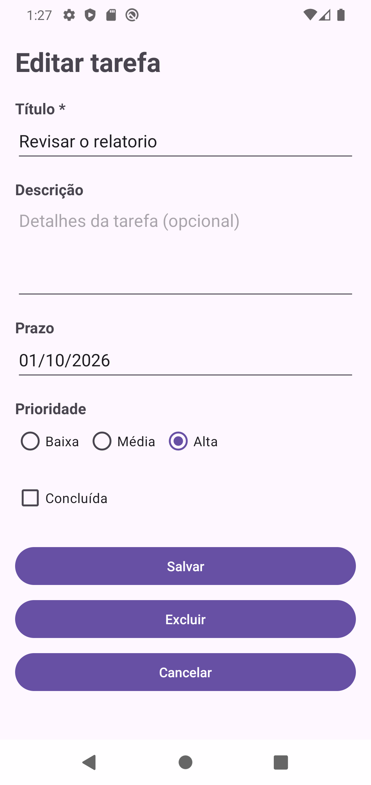

# TaskFlow

Aplicativo Android de tarefas com persistência local em SQLite, desenvolvido para o App 02 da disciplina de Desenvolvimento para Dispositivos Móveis.

## Integrantes

| Nome | GRR |
| --- | --- |
| Guilherme Gemniczak da Rocha | GRR20246173 |
| João Victor Timoteo | GRR20246658 |
| André Luiz Olmedo | GRR20152014 |

## Sobre o projeto

O TaskFlow é um aplicativo para organizar tarefas pessoais do dia a dia. Ele permite cadastrar, visualizar, editar e excluir tarefas com título, descrição, prazo, prioridade e situação. Os dados são armazenados localmente em SQLite e permanecem salvos após o aplicativo ser fechado ou o aparelho ser reiniciado.

## Regras de negócio, ordenação e filtros

- As tarefas podem estar pendentes, concluídas ou atrasadas.
- O aplicativo mostra a quantidade e o percentual de tarefas concluídas.
- A lista exibe primeiro as tarefas pendentes, depois considera prioridade, prazo e título.
- O usuário pode listar todas as tarefas, buscar pelo título ou filtrar por pendentes e concluídas.
- Título, tamanho dos textos e prazo são validados antes de salvar.

## Estrutura do projeto

- `model`: representação da tarefa.
- `db`: criação e atualização do banco SQLite.
- `dao`: operações de inserção, consulta, atualização, exclusão e filtros.
- `controller`: telas e comunicação com o banco.
- `adapter`: exibição das tarefas no `ListView`.
- `util`: validação e formatação de datas.

## Telas e navegação

O aplicativo possui uma tela principal com a lista, busca, filtros e resumo de progresso, além de uma tela de formulário para cadastrar, editar ou excluir uma tarefa. Ao tocar em um item da lista, seu identificador é enviado por `Intent` para a tela de edição.

| Tela principal | Formulário |
| --- | --- |
|  |  |

## Tecnologias

- Kotlin
- Android Views
- SQLite com `SQLiteOpenHelper`
- `ListView` com adapter personalizado
- API mínima 29

## Uso de inteligência artificial

Foram utilizadas ferramentas de inteligência artificial como apoio na geração de imagens e na depuração do código. O funcionamento e o resultado final foram revisados pelos integrantes do grupo.
